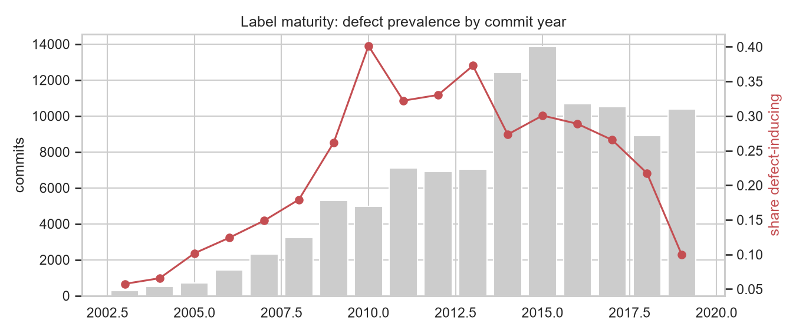
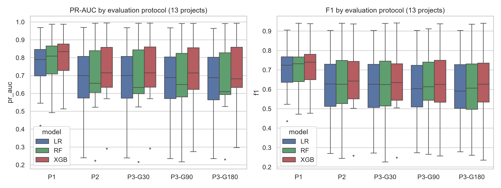
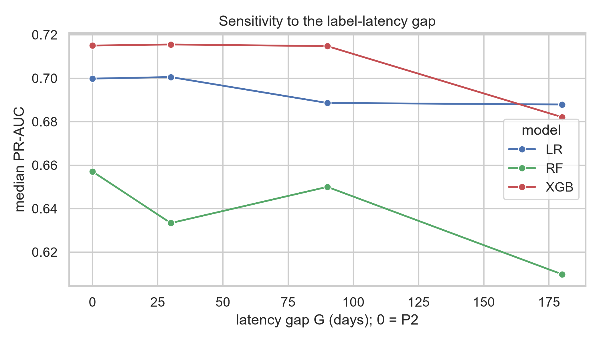
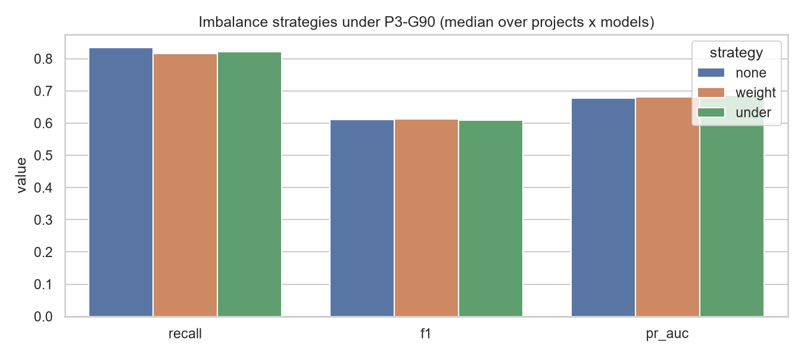
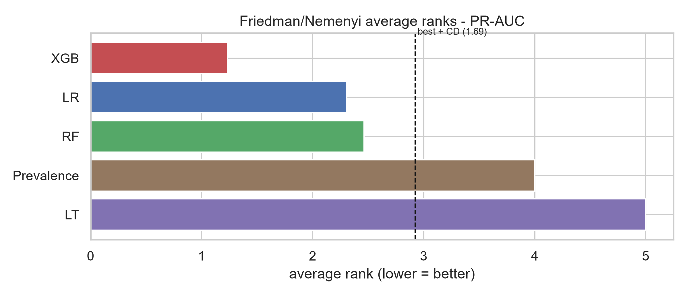
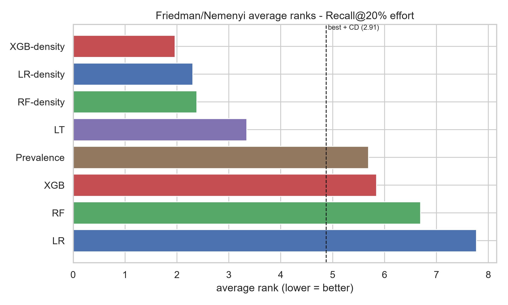
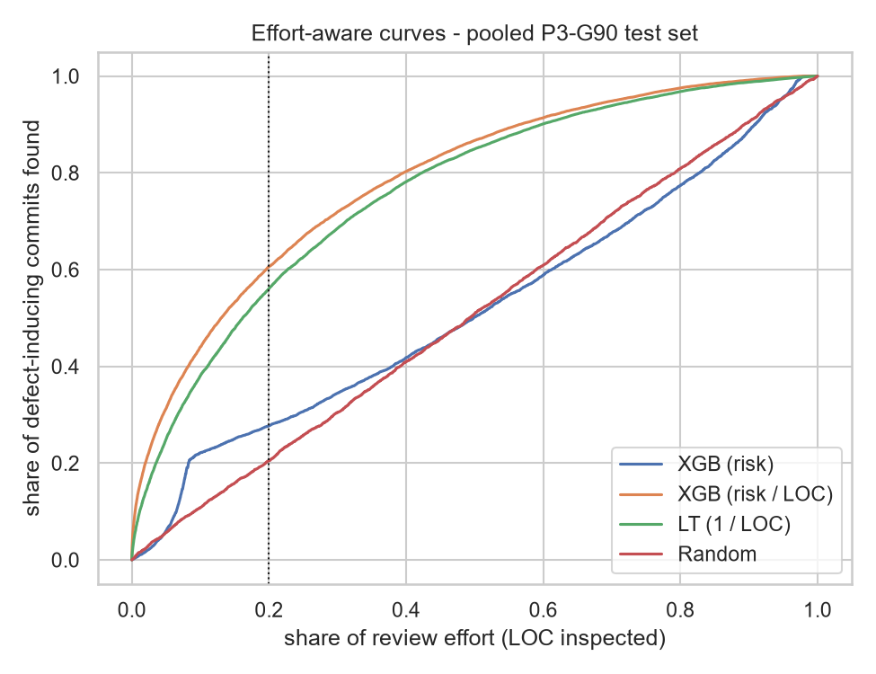
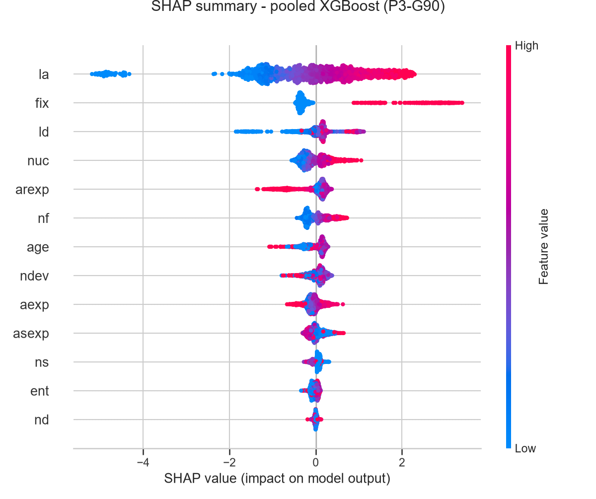
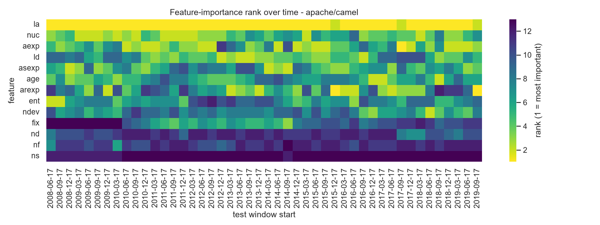
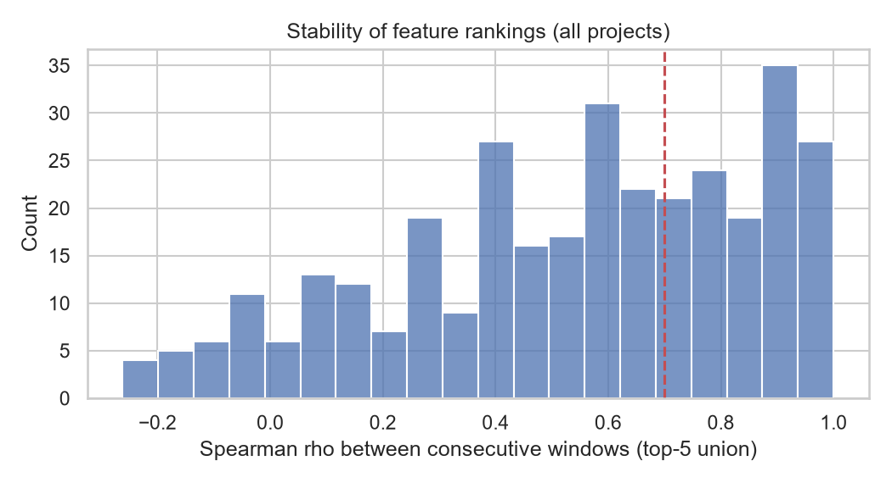

# Realistic Evaluation of ML-Based Just-in-Time Defect Prediction - Results

*Dataset: apachejit. Farida Hisham Ghariani, Alla Khaled Almuqadimi (CCTT, Tripoli). Generated automatically by `python run_all.py`.*

## Executive summary

| Hypothesis | Verdict |
|---|---|
| H1 - realistic evaluation lowers PR-AUC and F1 | **SUPPORTED** |
| H2 - class weighting helps; ML beats the unsupervised baseline on Recall@20% | **NOT SUPPORTED** |
| H3 - top-5 SHAP features stable across windows (rho >= 0.7) | **NOT SUPPORTED** |

- 13 projects retained, 344 rolling windows, 3,316 evaluated model/baseline runs.
- Best ranking model (PR-AUC, P3): **XGB**; best effort-aware model: **RF**. Prototype model: **XGB** (pooled test PR-AUC 0.7707).

## Dataset readiness gate and validation

- Commits: **106,674** from **15** projects; 2003-09-11 -> 2019-12-26; prevalence 0.265.
- SHA-256: `5097cbbbab8c4611a709b3cf95ac5c9fe5f62e619bab081911a2a247ddbed4e0`
- Missing values: 0; duplicate commit ids: 0; duplicate feature rows: 515; negative values: none.
- Fix-commit timestamps available: **no** -> P3 uses the gap approximation.
- Readiness gate: {"1_timestamp": true, "2_change_metrics": true, "3_labels_documented": true, "4_enough_pos_neg": true, "5_latency_protocol": true} -> **PASSED**

Pre-registered exclusion rule: a project is kept only if the chronological 70/30 split has at least 50 commits of each class in both parts.

| project                 |   commits |   train_pos |   train_neg |   test_pos |   test_neg | retained   | reason                                      |
|:------------------------|----------:|------------:|------------:|-----------:|-----------:|:-----------|:--------------------------------------------|
| apache/activemq         |      6126 |        1000 |        3288 |        404 |       1434 | True       |                                             |
| apache/camel            |     22700 |        2698 |       13192 |        380 |       6430 | True       |                                             |
| apache/cassandra        |      8159 |        2214 |        3497 |        903 |       1545 | True       |                                             |
| apache/flink            |     11691 |        2211 |        5972 |        600 |       2908 | True       |                                             |
| apache/groovy           |      8059 |        1221 |        4420 |        393 |       2025 | True       |                                             |
| apache/hadoop           |     11964 |           0 |        8374 |          0 |       3590 | False      | fewer than 50 commits of a class in a split |
| apache/hadoop-hdfs      |      2907 |        1502 |         532 |        720 |        153 | True       |                                             |
| apache/hadoop-mapreduce |      1321 |         511 |         413 |        327 |         70 | True       |                                             |
| apache/hbase            |      8730 |        3031 |        3080 |        751 |       1868 | True       |                                             |
| apache/hive             |      6842 |        3293 |        1496 |        930 |       1123 | True       |                                             |
| apache/ignite           |     12036 |        1309 |        7116 |       1130 |       2481 | True       |                                             |
| apache/kafka            |      2384 |         932 |         736 |        183 |        533 | True       |                                             |
| apache/spark            |      1465 |         518 |         507 |        114 |        326 | True       |                                             |
| apache/zeppelin         |      1451 |         454 |         561 |        168 |        268 | True       |                                             |
| apache/zookeeper        |       839 |         307 |         280 |         35 |        217 | False      | fewer than 50 commits of a class in a split |

> **Finding (data audit):** `apache/hadoop` has *zero* defect-inducing commits although its sub-projects `hadoop-hdfs` and `hadoop-mapreduce` have 76% and 63%; this looks like a labeling artefact of the repository split, so it is excluded rather than treated as a defect-free project.

### Improvement: label-maturity (right-censoring) check

Recent commits have had less time for their bugs to be found, so the newest 30% (test) has a lower observed prevalence than the oldest 70% in most projects. This is why we also report **PR-AUC lift** (PR-AUC / test prevalence), which compares protocols fairly when prevalence differs:

| project                 |   train_prev |   test_prev |   ratio |
|:------------------------|-------------:|------------:|--------:|
| apache/activemq         |        0.233 |       0.220 |   0.943 |
| apache/camel            |        0.170 |       0.056 |   0.329 |
| apache/cassandra        |        0.388 |       0.369 |   0.952 |
| apache/flink            |        0.270 |       0.171 |   0.633 |
| apache/groovy           |        0.216 |       0.163 |   0.751 |
| apache/hadoop-hdfs      |        0.738 |       0.825 |   1.117 |
| apache/hadoop-mapreduce |        0.553 |       0.824 |   1.489 |
| apache/hbase            |        0.496 |       0.287 |   0.578 |
| apache/hive             |        0.688 |       0.453 |   0.659 |
| apache/ignite           |        0.155 |       0.313 |   2.014 |
| apache/kafka            |        0.559 |       0.256 |   0.457 |
| apache/spark            |        0.505 |       0.259 |   0.513 |
| apache/zeppelin         |        0.447 |       0.385 |   0.861 |

## RQ1 - How much does performance fall under realistic evaluation?

Median across the retained projects (default strategy = class weighting):

|                    |   pr_auc |   pr_auc_lift |   roc_auc |    f1 |   mcc |   recall20 |
|:-------------------|---------:|--------------:|----------:|------:|------:|-----------:|
| ('P1', 'LR')       |    0.790 |         1.872 |     0.856 | 0.724 | 0.516 |      0.118 |
| ('P1', 'RF')       |    0.809 |         1.997 |     0.874 | 0.732 | 0.561 |      0.207 |
| ('P1', 'XGB')      |    0.834 |         2.001 |     0.878 | 0.740 | 0.578 |      0.229 |
| ('P2', 'LR')       |    0.700 |         2.533 |     0.830 | 0.627 | 0.393 |      0.120 |
| ('P2', 'RF')       |    0.657 |         2.445 |     0.837 | 0.626 | 0.399 |      0.158 |
| ('P2', 'XGB')      |    0.715 |         2.524 |     0.845 | 0.642 | 0.454 |      0.215 |
| ('P3-G30', 'LR')   |    0.701 |         2.533 |     0.829 | 0.626 | 0.399 |      0.121 |
| ('P3-G30', 'RF')   |    0.633 |         2.420 |     0.835 | 0.625 | 0.407 |      0.182 |
| ('P3-G30', 'XGB')  |    0.716 |         2.512 |     0.845 | 0.635 | 0.468 |      0.193 |
| ('P3-G90', 'LR')   |    0.689 |         2.525 |     0.828 | 0.603 | 0.396 |      0.119 |
| ('P3-G90', 'RF')   |    0.650 |         2.376 |     0.823 | 0.613 | 0.410 |      0.158 |
| ('P3-G90', 'XGB')  |    0.715 |         2.510 |     0.844 | 0.626 | 0.443 |      0.202 |
| ('P3-G180', 'LR')  |    0.688 |         2.520 |     0.825 | 0.591 | 0.372 |      0.121 |
| ('P3-G180', 'RF')  |    0.610 |         2.304 |     0.825 | 0.606 | 0.387 |      0.163 |
| ('P3-G180', 'XGB') |    0.682 |         2.477 |     0.838 | 0.626 | 0.428 |      0.178 |

Paired one-sided Wilcoxon signed-rank tests over (project, model) pairs (alternative: the first protocol scores higher):

|                                           |   n |   median_a |   median_b |   median_diff | p      |   cliffs_delta | magnitude   |
|:------------------------------------------|----:|-----------:|-----------:|--------------:|:-------|---------------:|:------------|
| ('P1 vs P3 (H1)', 'pr_auc')               |  39 |      0.809 |      0.681 |         0.070 | <0.001 |          0.256 | small       |
| ('P1 vs P2 (splitting)', 'pr_auc')        |  39 |      0.809 |      0.700 |         0.071 | <0.001 |          0.239 | small       |
| ('P2 vs P3 (latency gap)', 'pr_auc')      |  39 |      0.700 |      0.681 |         0.004 | <0.001 |          0.034 | negligible  |
| ('P1 vs P3 (H1)', 'f1')                   |  39 |      0.725 |      0.613 |         0.093 | <0.001 |          0.278 | small       |
| ('P1 vs P2 (splitting)', 'f1')            |  39 |      0.725 |      0.627 |         0.083 | <0.001 |          0.274 | small       |
| ('P2 vs P3 (latency gap)', 'f1')          |  39 |      0.627 |      0.613 |         0.003 | 0.143  |          0.021 | negligible  |
| ('P1 vs P3 (H1)', 'pr_auc_lift')          |  39 |      1.997 |      2.425 |        -0.132 | 0.983  |         -0.108 | negligible  |
| ('P1 vs P2 (splitting)', 'pr_auc_lift')   |  39 |      1.997 |      2.472 |        -0.153 | 0.989  |         -0.115 | negligible  |
| ('P2 vs P3 (latency gap)', 'pr_auc_lift') |  39 |      2.472 |      2.425 |         0.016 | <0.001 |          0.037 | negligible  |
| ('P1 vs P3 (H1)', 'mcc')                  |  39 |      0.546 |      0.410 |         0.118 | <0.001 |          0.561 | large       |
| ('P1 vs P2 (splitting)', 'mcc')           |  39 |      0.546 |      0.424 |         0.114 | <0.001 |          0.499 | large       |
| ('P2 vs P3 (latency gap)', 'mcc')         |  39 |      0.424 |      0.410 |         0.007 | 0.085  |          0.063 | negligible  |

Rolling windows: each realistic window (train 12 m -> gap 90 d -> test 3 m) is paired with a shuffled split of the *same commits* (random vs realistic):

| metric      |    n |   median_a |   median_b |   median_diff | p      |   cliffs_delta | magnitude   |
|:------------|-----:|-----------:|-----------:|--------------:|:-------|---------------:|:------------|
| pr_auc      | 1032 |      0.781 |      0.761 |         0.019 | <0.001 |          0.056 | negligible  |
| f1          | 1032 |      0.682 |      0.667 |         0.022 | <0.001 |          0.066 | negligible  |
| pr_auc_lift | 1032 |      2.103 |      2.076 |         0.007 | 0.072  |          0.048 | negligible  |

**H1 verdict: SUPPORTED.** Median paired drop P1 -> P3-G90: PR-AUC +0.070, F1 +0.093.

Sensitivity analysis over G (medians):

| protocol   |   ('pr_auc', 'LR') |   ('pr_auc', 'RF') |   ('pr_auc', 'XGB') |   ('f1', 'LR') |   ('f1', 'RF') |   ('f1', 'XGB') |
|:-----------|-------------------:|-------------------:|--------------------:|---------------:|---------------:|----------------:|
| P2         |              0.700 |              0.657 |               0.715 |          0.627 |          0.626 |           0.642 |
| P3-G30     |              0.701 |              0.633 |               0.716 |          0.626 |          0.625 |           0.635 |
| P3-G90     |              0.689 |              0.650 |               0.715 |          0.603 |          0.613 |           0.626 |
| P3-G180    |              0.688 |              0.610 |               0.682 |          0.591 |          0.606 |           0.626 |

## RQ2 - Imbalance strategies, models and baselines under P3

Median over projects under P3-G90:

|                   |   precision |   recall |    f1 |   mcc |   pr_auc |   recall20 |
|:------------------|------------:|---------:|------:|------:|---------:|-----------:|
| ('none', 'LR')    |       0.454 |    0.834 | 0.599 | 0.375 |    0.689 |      0.119 |
| ('none', 'RF')    |       0.492 |    0.827 | 0.616 | 0.421 |    0.650 |      0.168 |
| ('none', 'XGB')   |       0.550 |    0.850 | 0.618 | 0.457 |    0.718 |      0.211 |
| ('under', 'LR')   |       0.477 |    0.833 | 0.602 | 0.364 |    0.687 |      0.115 |
| ('under', 'RF')   |       0.484 |    0.821 | 0.609 | 0.399 |    0.632 |      0.165 |
| ('under', 'XGB')  |       0.512 |    0.810 | 0.630 | 0.427 |    0.709 |      0.198 |
| ('weight', 'LR')  |       0.460 |    0.837 | 0.603 | 0.396 |    0.689 |      0.119 |
| ('weight', 'RF')  |       0.500 |    0.810 | 0.613 | 0.410 |    0.650 |      0.158 |
| ('weight', 'XGB') |       0.531 |    0.815 | 0.626 | 0.443 |    0.715 |      0.202 |

Wilcoxon tests (pairs = project x model):

|                              | alternative   |   n |   median_a |   median_b |   median_diff |     p |   cliffs_delta | magnitude   |
|:-----------------------------|:--------------|----:|-----------:|-----------:|--------------:|------:|---------------:|:------------|
| ('weight vs none', 'recall') | greater       |  39 |      0.815 |      0.834 |        -0.006 | 0.894 |         -0.030 | negligible  |
| ('under vs none', 'recall')  | greater       |  39 |      0.821 |      0.834 |         0.000 | 0.449 |         -0.020 | negligible  |
| ('weight vs none', 'f1')     | greater       |  39 |      0.613 |      0.610 |         0.001 | 0.389 |          0.004 | negligible  |
| ('under vs none', 'f1')      | greater       |  39 |      0.609 |      0.610 |        -0.003 | 0.955 |         -0.026 | negligible  |
| ('weight vs none', 'pr_auc') | two-sided     |  39 |      0.681 |      0.678 |        -0.000 | 0.104 |         -0.020 | negligible  |
| ('under vs none', 'pr_auc')  | two-sided     |  39 |      0.686 |      0.678 |        -0.003 | 0.003 |         -0.036 | negligible  |

Friedman test on PR-AUC across 13 projects: chi2 = 46.28, p = <0.001; Nemenyi CD = 1.69. Average ranks (1 = best):

| model      |   avg_rank |
|:-----------|-----------:|
| XGB        |      1.231 |
| LR         |      2.308 |
| RF         |      2.462 |
| Prevalence |      4.000 |
| LT         |      5.000 |

Friedman test on Recall@20% effort: chi2 = 77.75, p = <0.001; CD = 2.91. Average ranks:

|             |   avg_rank |
|:------------|-----------:|
| XGB-density |      1.962 |
| LR-density  |      2.308 |
| RF-density  |      2.385 |
| LT          |      3.346 |
| Prevalence  |      5.692 |
| XGB         |      5.846 |
| RF          |      6.692 |
| LR          |      7.769 |

Recall@20% effort of each supervised ranker vs the unsupervised LT baseline (one-sided Wilcoxon over projects):

| ranker      |   n |   median_a |   median_b |   median_diff |     p |   cliffs_delta | magnitude   |
|:------------|----:|-----------:|-----------:|--------------:|------:|---------------:|:------------|
| LR          |  13 |      0.119 |      0.588 |        -0.438 | 1.000 |         -1.000 | large       |
| RF          |  13 |      0.158 |      0.588 |        -0.397 | 1.000 |         -0.988 | large       |
| XGB         |  13 |      0.202 |      0.588 |        -0.363 | 1.000 |         -0.988 | large       |
| LR-density  |  13 |      0.594 |      0.588 |         0.018 | 0.013 |          0.160 | small       |
| RF-density  |  13 |      0.594 |      0.588 |         0.011 | 0.008 |          0.118 | negligible  |
| XGB-density |  13 |      0.587 |      0.588 |         0.020 | 0.016 |          0.148 | small       |

**H2 verdict: NOT SUPPORTED.** (a) class weighting improves recall and F1 without lowering PR-AUC: no; (b) an ML model (risk ranking) beats LT on Recall@20% effort: no. Improvement - ranking by *risk per changed line* (density) beats LT: yes.

Model-selection rule (median over projects):

| model   |   pr_auc |   recall |    f1 |   recall20 |   recall20_density |   popt_density |
|:--------|---------:|---------:|------:|-----------:|-------------------:|---------------:|
| LR      |    0.689 |    0.837 | 0.603 |      0.119 |              0.594 |          0.857 |
| RF      |    0.650 |    0.810 | 0.613 |      0.158 |              0.594 |          0.856 |
| XGB     |    0.715 |    0.815 | 0.626 |      0.202 |              0.587 |          0.859 |

Best PR-AUC: **XGB**; best effort-aware recall (density ranking): **RF** (different models -> trade-off: XGB ranks risk best, RF finds the most defects per review effort).

## RQ3 - Which features matter, and are they stable over time?

Consecutive-window stability of XGBoost mean |SHAP| rankings:

| project                 |   rho_top5 |   rho_all |   jaccard_top5 |   pairs |
|:------------------------|-----------:|----------:|---------------:|--------:|
| apache/activemq         |      0.486 |     0.816 |          0.667 |  36.000 |
| apache/camel            |      0.429 |     0.841 |          0.667 |  45.000 |
| apache/cassandra        |      0.679 |     0.824 |          0.667 |  33.000 |
| apache/flink            |      0.586 |     0.821 |          0.667 |  24.000 |
| apache/groovy           |      0.286 |     0.845 |          0.667 |  43.000 |
| apache/hadoop-hdfs      |      0.286 |     0.620 |          0.548 |   8.000 |
| apache/hadoop-mapreduce |      0.600 |     0.780 |          0.667 |   1.000 |
| apache/hbase            |      0.771 |     0.865 |          0.667 |  44.000 |
| apache/hive             |      0.771 |     0.841 |          0.667 |  37.000 |
| apache/ignite           |      0.679 |     0.835 |          0.667 |  17.000 |
| apache/kafka            |      0.600 |     0.838 |          0.667 |  14.000 |
| apache/spark            |      0.393 |     0.717 |          0.429 |  16.000 |
| apache/zeppelin         |      0.607 |     0.758 |          0.667 |  13.000 |

Overall median Spearman (top-5 union) = 0.60; 38% of consecutive pairs reach 0.7; median full-ranking Spearman = 0.84; median top-5 Jaccard = 0.67.

**H3 verdict: NOT SUPPORTED.**

How often each feature is in the top-5 across all windows:

| feature   |   share_of_windows_in_top5 |
|:----------|---------------------------:|
| la        |                      1.000 |
| ld        |                      0.735 |
| fix       |                      0.642 |
| nuc       |                      0.593 |
| age       |                      0.515 |
| aexp      |                      0.334 |
| ent       |                      0.308 |
| asexp     |                      0.291 |
| arexp     |                      0.221 |
| ndev      |                      0.209 |
| nd        |                      0.102 |
| nf        |                      0.044 |
| ns        |                      0.006 |

Pooled P3-G90 XGBoost - global mean |SHAP|:

|       |   mean_abs_shap |
|:------|----------------:|
| la    |           1.026 |
| fix   |           0.566 |
| ld    |           0.247 |
| nuc   |           0.240 |
| arexp |           0.224 |
| nf    |           0.205 |
| age   |           0.178 |
| ndev  |           0.143 |
| aexp  |           0.134 |
| asexp |           0.125 |
| ns    |           0.075 |
| ent   |           0.059 |
| nd    |           0.022 |

Pooled P3-G90 Logistic Regression coefficients (standardized, after log1p; collinearity filter dropped: nd, ent, arexp):

| feature   |   coef |   odds_ratio_per_sd |
|:----------|-------:|--------------------:|
| la        |  1.037 |               2.821 |
| fix       |  0.746 |               2.108 |
| nuc       |  0.451 |               1.570 |
| ld        |  0.232 |               1.262 |
| age       |  0.119 |               1.127 |
| nf        |  0.081 |               1.084 |
| asexp     | -0.060 |               0.942 |
| ns        |  0.048 |               1.049 |
| aexp      | -0.041 |               0.960 |
| ndev      | -0.030 |               0.971 |

## Pooled analysis (all retained projects, global time order)

PR-AUC per protocol:

| model      |    P1 |    P2 |   P3-G30 |   P3-G90 |   P3-G180 |
|:-----------|------:|------:|---------:|---------:|----------:|
| LR         | 0.738 | 0.710 |    0.710 |    0.709 |     0.708 |
| LT         | 0.195 | 0.154 |    0.154 |    0.154 |     0.154 |
| Prevalence | 0.297 | 0.247 |    0.247 |    0.247 |     0.247 |
| RF         | 0.800 | 0.762 |    0.761 |    0.760 |     0.758 |
| XGB        | 0.804 | 0.772 |    0.771 |    0.771 |     0.769 |

All metrics, pooled P3-G90:

| model      |   precision |   recall |    f1 |    mcc |   pr_auc |   pr_auc_lift |   roc_auc |   recall20 |   recall20_density |   popt_density |   brier |   accuracy |
|:-----------|------------:|---------:|------:|-------:|---------:|--------------:|----------:|-----------:|-------------------:|---------------:|--------:|-----------:|
| LR         |       0.517 |    0.803 | 0.629 |  0.494 |    0.709 |         2.871 |     0.860 |      0.161 |              0.587 |          0.845 |   0.181 |      0.766 |
| RF         |       0.524 |    0.834 | 0.643 |  0.516 |    0.760 |         3.076 |     0.878 |      0.257 |              0.600 |          0.852 |   0.164 |      0.771 |
| XGB        |       0.542 |    0.823 | 0.654 |  0.530 |    0.771 |         3.118 |     0.882 |      0.277 |              0.606 |          0.856 |   0.164 |      0.785 |
| Prevalence |       0.000 |    0.000 | 0.000 |  0.000 |    0.247 |         1.000 |     0.500 |      0.200 |              0.561 |          0.825 | nan     |      0.753 |
| LT         |       0.060 |    0.073 | 0.066 | -0.287 |    0.154 |         0.624 |     0.215 |      0.561 |              0.561 |          0.825 | nan     |      0.486 |

95% bootstrap confidence intervals of PR-AUC (pooled P3 test set, 1000 resamples):

| model   |   pr_auc |   ci_low |   ci_high |
|:--------|---------:|---------:|----------:|
| LR      |    0.709 |    0.699 |     0.720 |
| RF      |    0.760 |    0.751 |     0.769 |
| XGB     |    0.771 |    0.762 |     0.779 |

Confusion matrices at the validation-selected threshold:

| model   |   tp |   fp |   fn |    tn |
|:--------|-----:|-----:|-----:|------:|
| LR      | 5587 | 5210 | 1373 | 15992 |
| RF      | 5804 | 5280 | 1156 | 15922 |
| XGB     | 5731 | 4835 | 1229 | 16367 |

## Prototype

`python predict.py --example` scores held-out commits; `python predict.py --la 120 --ld 30 --nf 4 ...` scores a single record. Model metadata: `{"model": "XGB", "strategy": "weight", "params": {"max_depth": 6, "learning_rate": 0.03}, "protocol": "P3-G90 (pooled)", "dataset_sha256": "5097cbbbab8c4611a709b3cf95ac5c9fe5f62e619bab081911a2a247ddbed4e0", "trained_on": 63413, "test_pr_auc": 0.7707, "test_recall20": 0.2771, "version": "1.0", "created": "2026-11-19T14:07:55"}`

## Automated leakage checks

Every split passes `check_split` before training (forbidden fields absent, no shared commits, training dates precede test dates, gap respected); preprocessing and resampling are fitted inside the training pipeline only; test data are never resampled; thresholds come from validation data. See `tests/test_pipeline.py`.

## Improvements beyond the proposal

1. **Data audit** found and excluded the label-less `apache/hadoop` project.
2. **Label-maturity check** + **PR-AUC lift** to compare protocols whose test prevalence differs.
3. **Paired random-vs-realistic windows**: the same commits evaluated both ways, a much more powerful test of H1 than comparing different test sets.
4. **Effort-aware supervised ranking** (risk per changed line) in addition to the raw risk ranking.
5. **Calibration (Brier score)** and **bootstrap confidence intervals**.
6. **Collinearity filter** (Spearman |rho| > 0.8) for interpretable LR coefficients.
7. **Three-level risk prototype** with thresholds from validation data (High = F1-optimal threshold, Low = below the 90%-recall threshold).

## Limitations

- SZZ labels are noisy; no fix timestamps, so latency is approximated by a gap.
- Rolling windows use fixed default hyper-parameters (tuning is done for P1/P2/P3).
- Effort = lines added + deleted is a simplification of review effort.
- Apache Java projects may not generalize to other ecosystems.

## Environment

`{"python": "3.12.10", "numpy": "2.5.5", "pandas": "3.1.1", "scikit-learn": "1.9.1", "xgboost": "3.4.1", "imbalanced-learn": "0.14.2", "shap": "0.54.1", "scipy": "1.18.1"}`
