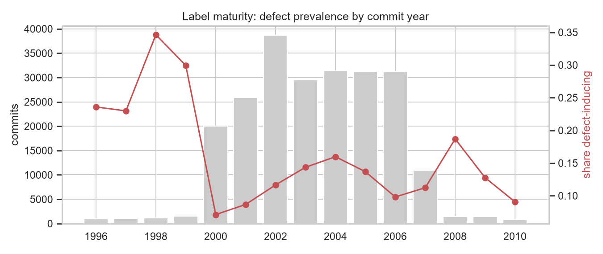
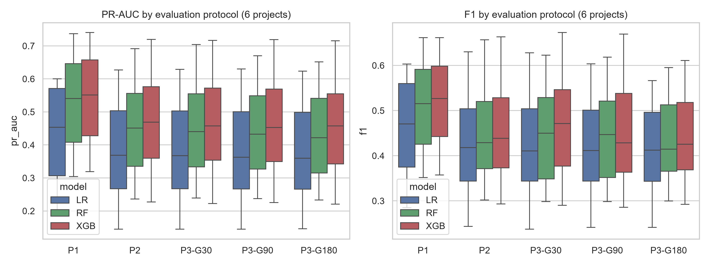
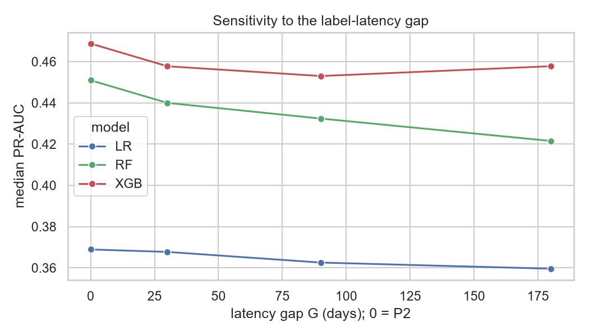
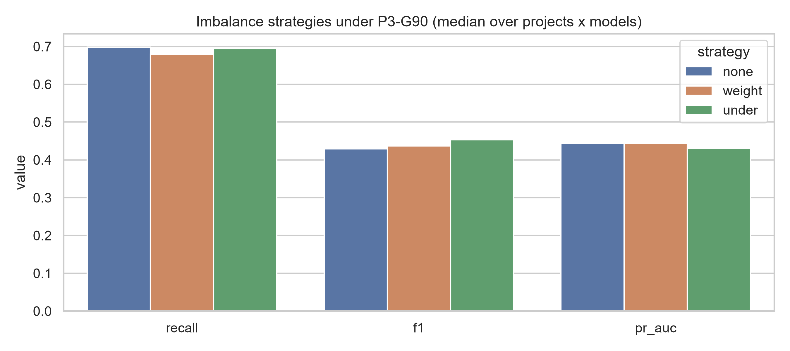
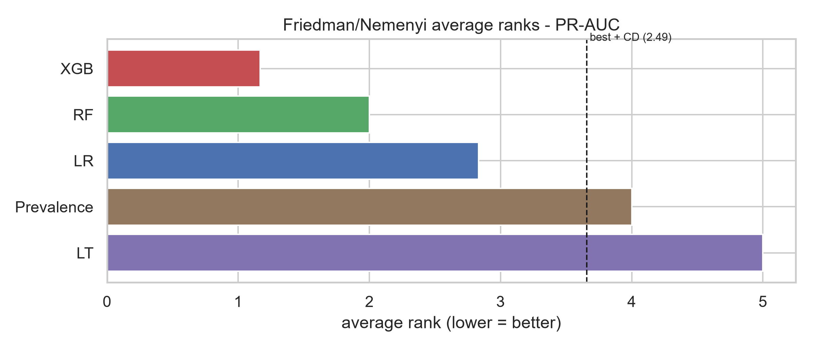
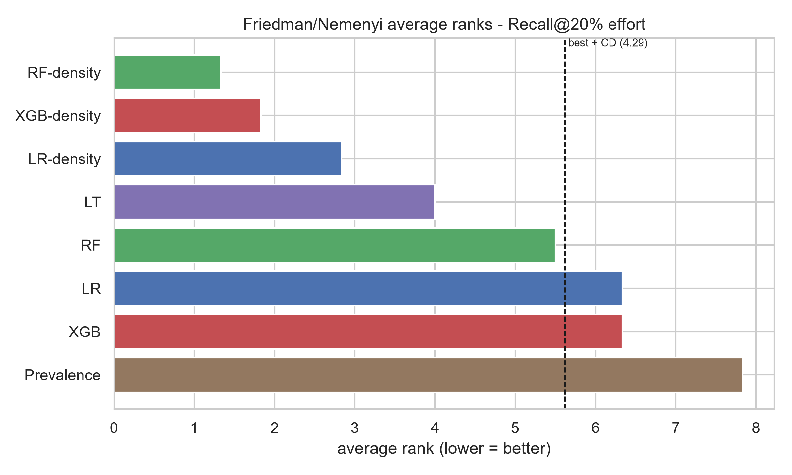
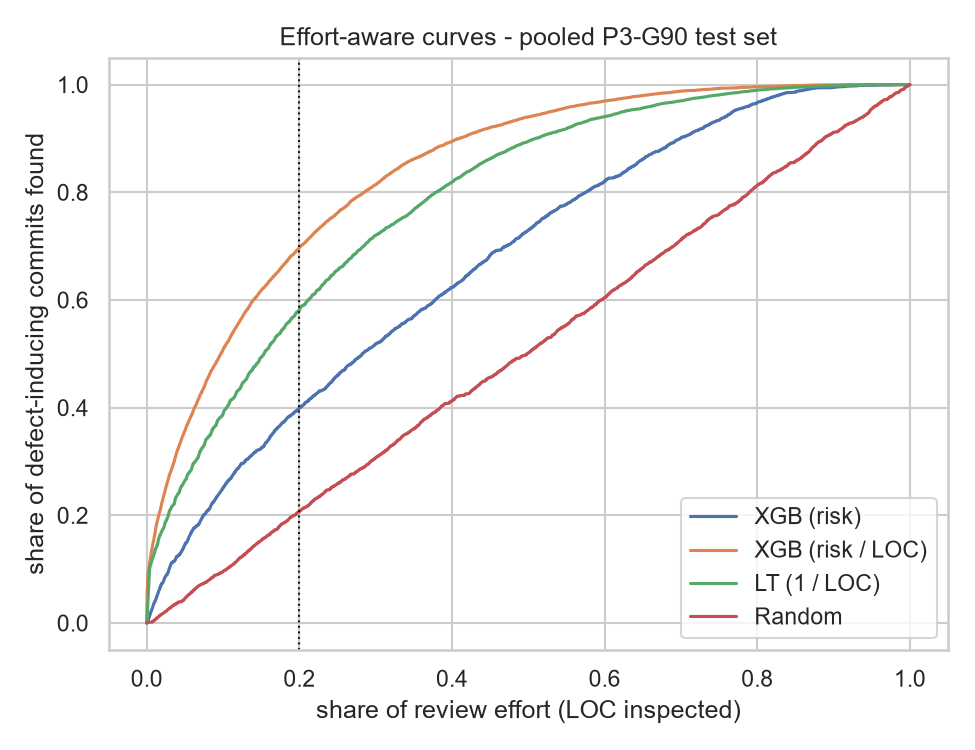
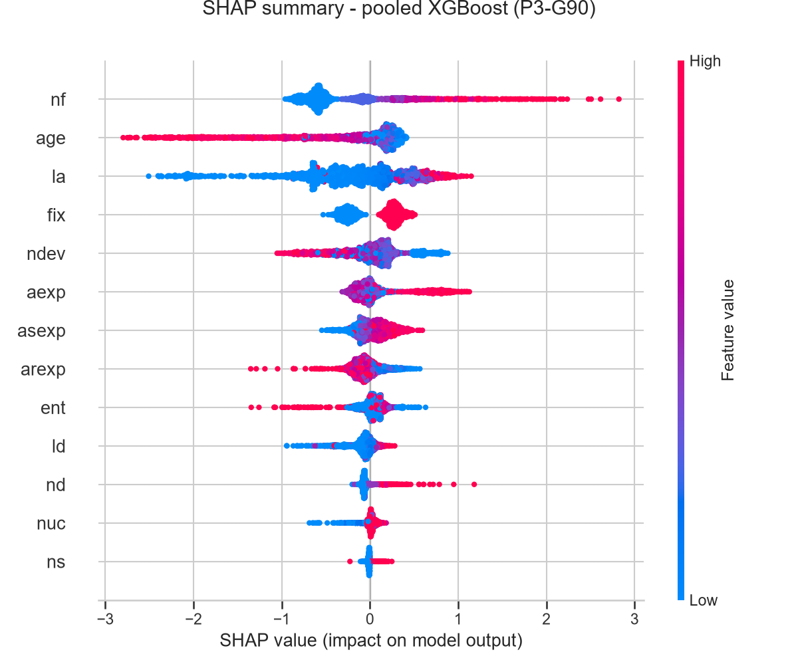
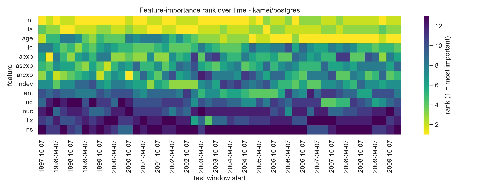
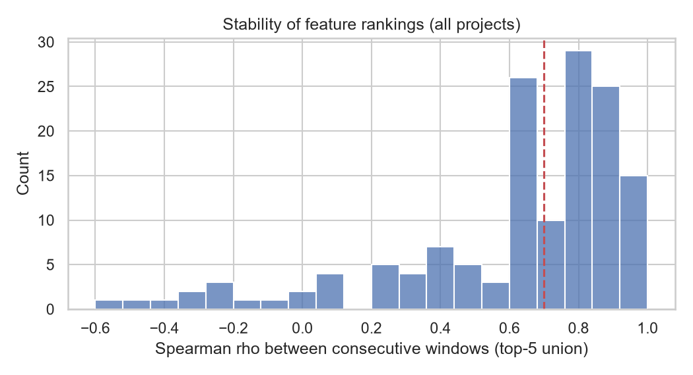

# Realistic Evaluation of ML-Based Just-in-Time Defect Prediction - Results

*Dataset: kamei. Farida Hisham Ghariani, Alla Khaled Almuqadimi (CCTT, Tripoli). Generated automatically by `python run_all.py`.*

## Executive summary

| Hypothesis | Verdict |
|---|---|
| H1 - realistic evaluation lowers PR-AUC and F1 | **SUPPORTED** |
| H2 - class weighting helps; ML beats the unsupervised baseline on Recall@20% | **NOT SUPPORTED** |
| H3 - top-5 SHAP features stable across windows (rho >= 0.7) | **SUPPORTED** |

- 6 projects retained, 151 rolling windows, 1,485 evaluated model/baseline runs.
- Best ranking model (PR-AUC, P3): **XGB**; best effort-aware model: **RF**. Prototype model: **XGB** (pooled test PR-AUC 0.4036).

## Dataset readiness gate and validation

- Commits: **227,417** from **6** projects; 1996-07-09 -> 2010-05-15; prevalence 0.123.
- SHA-256: `db1ccef8fa1f4be3ed695b6b49a526b04cab9a1758fa5f1c722309027c5caa09`
- Missing values: 0; duplicate commit ids: 0; duplicate feature rows: 4829; negative values: none.
- Fix-commit timestamps available: **no** -> P3 uses the gap approximation.
- Readiness gate: {"1_timestamp": true, "2_change_metrics": true, "3_labels_documented": true, "4_enough_pos_neg": true, "5_latency_protocol": true} -> **PASSED**

Pre-registered exclusion rule: a project is kept only if the chronological 70/30 split has at least 50 commits of each class in both parts.

| project        |   commits |   train_pos |   train_neg |   test_pos |   test_neg | retained   | reason   |
|:---------------|----------:|------------:|------------:|-----------:|-----------:|:-----------|:---------|
| kamei/bugzilla |      4620 |        1268 |        1966 |        428 |        958 | True       |          |
| kamei/columba  |      4455 |        1052 |        2066 |        309 |       1028 | True       |          |
| kamei/jdt      |     35386 |        3842 |       20928 |       1247 |       9369 | True       |          |
| kamei/mozilla  |     98275 |        4060 |       64732 |       1089 |      28394 | True       |          |
| kamei/platform |     64250 |        6600 |       38375 |       2852 |      16423 | True       |          |
| kamei/postgres |     20431 |        4043 |       10258 |       1076 |       5054 | True       |          |

### Improvement: label-maturity (right-censoring) check

Recent commits have had less time for their bugs to be found, so the newest 30% (test) has a lower observed prevalence than the oldest 70% in most projects. This is why we also report **PR-AUC lift** (PR-AUC / test prevalence), which compares protocols fairly when prevalence differs:

| project        |   train_prev |   test_prev |   ratio |
|:---------------|-------------:|------------:|--------:|
| kamei/bugzilla |        0.392 |       0.309 |   0.788 |
| kamei/columba  |        0.337 |       0.231 |   0.685 |
| kamei/jdt      |        0.155 |       0.117 |   0.757 |
| kamei/mozilla  |        0.059 |       0.037 |   0.626 |
| kamei/platform |        0.147 |       0.148 |   1.008 |
| kamei/postgres |        0.283 |       0.176 |   0.621 |

## RQ1 - How much does performance fall under realistic evaluation?

Median across the retained projects (default strategy = class weighting):

|                    |   pr_auc |   pr_auc_lift |   roc_auc |    f1 |   mcc |   recall20 |
|:-------------------|---------:|--------------:|----------:|------:|------:|-----------:|
| ('P1', 'LR')       |    0.454 |         2.171 |     0.737 | 0.470 | 0.285 |      0.282 |
| ('P1', 'RF')       |    0.541 |         2.667 |     0.806 | 0.515 | 0.363 |      0.361 |
| ('P1', 'XGB')      |    0.552 |         2.762 |     0.812 | 0.527 | 0.370 |      0.349 |
| ('P2', 'LR')       |    0.369 |         2.145 |     0.756 | 0.418 | 0.251 |      0.286 |
| ('P2', 'RF')       |    0.451 |         2.745 |     0.810 | 0.429 | 0.295 |      0.345 |
| ('P2', 'XGB')      |    0.469 |         2.933 |     0.815 | 0.438 | 0.312 |      0.332 |
| ('P3-G30', 'LR')   |    0.368 |         2.149 |     0.756 | 0.411 | 0.238 |      0.284 |
| ('P3-G30', 'RF')   |    0.440 |         2.733 |     0.808 | 0.450 | 0.301 |      0.342 |
| ('P3-G30', 'XGB')  |    0.458 |         2.897 |     0.814 | 0.471 | 0.325 |      0.325 |
| ('P3-G90', 'LR')   |    0.363 |         2.151 |     0.756 | 0.412 | 0.240 |      0.297 |
| ('P3-G90', 'RF')   |    0.432 |         2.689 |     0.807 | 0.447 | 0.292 |      0.350 |
| ('P3-G90', 'XGB')  |    0.453 |         2.864 |     0.813 | 0.428 | 0.311 |      0.326 |
| ('P3-G180', 'LR')  |    0.360 |         2.140 |     0.757 | 0.412 | 0.239 |      0.310 |
| ('P3-G180', 'RF')  |    0.422 |         2.606 |     0.797 | 0.414 | 0.296 |      0.357 |
| ('P3-G180', 'XGB') |    0.458 |         2.821 |     0.811 | 0.426 | 0.312 |      0.348 |

Paired one-sided Wilcoxon signed-rank tests over (project, model) pairs (alternative: the first protocol scores higher):

|                                           |   n |   median_a |   median_b |   median_diff | p      |   cliffs_delta | magnitude   |
|:------------------------------------------|----:|-----------:|-----------:|--------------:|:-------|---------------:|:------------|
| ('P1 vs P3 (H1)', 'pr_auc')               |  18 |      0.510 |      0.444 |         0.063 | <0.001 |          0.228 | small       |
| ('P1 vs P2 (splitting)', 'pr_auc')        |  18 |      0.510 |      0.459 |         0.059 | <0.001 |          0.204 | small       |
| ('P2 vs P3 (latency gap)', 'pr_auc')      |  18 |      0.459 |      0.444 |         0.002 | 0.003  |          0.049 | negligible  |
| ('P1 vs P3 (H1)', 'f1')                   |  18 |      0.505 |      0.437 |         0.044 | <0.001 |          0.228 | small       |
| ('P1 vs P2 (splitting)', 'f1')            |  18 |      0.505 |      0.429 |         0.043 | <0.001 |          0.235 | small       |
| ('P2 vs P3 (latency gap)', 'f1')          |  18 |      0.429 |      0.437 |         0.003 | 0.019  |          0.049 | negligible  |
| ('P1 vs P3 (H1)', 'pr_auc_lift')          |  18 |      2.431 |      2.595 |        -0.067 | 0.894  |         -0.080 | negligible  |
| ('P1 vs P2 (splitting)', 'pr_auc_lift')   |  18 |      2.431 |      2.689 |        -0.104 | 0.963  |         -0.136 | negligible  |
| ('P2 vs P3 (latency gap)', 'pr_auc_lift') |  18 |      2.689 |      2.595 |         0.023 | 0.005  |          0.056 | negligible  |
| ('P1 vs P3 (H1)', 'mcc')                  |  18 |      0.334 |      0.272 |         0.025 | 0.009  |          0.278 | small       |
| ('P1 vs P2 (splitting)', 'mcc')           |  18 |      0.334 |      0.273 |         0.021 | 0.059  |          0.222 | small       |
| ('P2 vs P3 (latency gap)', 'mcc')         |  18 |      0.273 |      0.272 |         0.004 | 0.012  |          0.043 | negligible  |

Rolling windows: each realistic window (train 12 m -> gap 90 d -> test 3 m) is paired with a shuffled split of the *same commits* (random vs realistic):

| metric      |   n |   median_a |   median_b |   median_diff | p      |   cliffs_delta | magnitude   |
|:------------|----:|-----------:|-----------:|--------------:|:-------|---------------:|:------------|
| pr_auc      | 453 |      0.540 |      0.495 |         0.037 | <0.001 |          0.146 | negligible  |
| f1          | 453 |      0.513 |      0.465 |         0.033 | <0.001 |          0.180 | small       |
| pr_auc_lift | 453 |      2.369 |      2.250 |         0.109 | <0.001 |          0.089 | negligible  |

**H1 verdict: SUPPORTED.** Median paired drop P1 -> P3-G90: PR-AUC +0.063, F1 +0.044.

Sensitivity analysis over G (medians):

| protocol   |   ('pr_auc', 'LR') |   ('pr_auc', 'RF') |   ('pr_auc', 'XGB') |   ('f1', 'LR') |   ('f1', 'RF') |   ('f1', 'XGB') |
|:-----------|-------------------:|-------------------:|--------------------:|---------------:|---------------:|----------------:|
| P2         |              0.369 |              0.451 |               0.469 |          0.418 |          0.429 |           0.438 |
| P3-G30     |              0.368 |              0.440 |               0.458 |          0.411 |          0.450 |           0.471 |
| P3-G90     |              0.363 |              0.432 |               0.453 |          0.412 |          0.447 |           0.428 |
| P3-G180    |              0.360 |              0.422 |               0.458 |          0.412 |          0.414 |           0.426 |

## RQ2 - Imbalance strategies, models and baselines under P3

Median over projects under P3-G90:

|                   |   precision |   recall |    f1 |   mcc |   pr_auc |   recall20 |
|:------------------|------------:|---------:|------:|------:|---------:|-----------:|
| ('none', 'LR')    |       0.269 |    0.718 | 0.397 | 0.227 |    0.366 |      0.304 |
| ('none', 'RF')    |       0.288 |    0.691 | 0.422 | 0.272 |    0.438 |      0.321 |
| ('none', 'XGB')   |       0.306 |    0.682 | 0.435 | 0.300 |    0.444 |      0.318 |
| ('under', 'LR')   |       0.295 |    0.694 | 0.412 | 0.242 |    0.358 |      0.335 |
| ('under', 'RF')   |       0.328 |    0.690 | 0.446 | 0.290 |    0.416 |      0.351 |
| ('under', 'XGB')  |       0.331 |    0.673 | 0.455 | 0.312 |    0.454 |      0.330 |
| ('weight', 'LR')  |       0.289 |    0.679 | 0.412 | 0.240 |    0.363 |      0.297 |
| ('weight', 'RF')  |       0.320 |    0.694 | 0.447 | 0.292 |    0.432 |      0.350 |
| ('weight', 'XGB') |       0.306 |    0.661 | 0.428 | 0.311 |    0.453 |      0.326 |

Wilcoxon tests (pairs = project x model):

|                              | alternative   |   n |   median_a |   median_b |   median_diff |     p |   cliffs_delta | magnitude   |
|:-----------------------------|:--------------|----:|-----------:|-----------:|--------------:|------:|---------------:|:------------|
| ('weight vs none', 'recall') | greater       |  18 |      0.680 |      0.699 |        -0.022 | 0.932 |         -0.090 | negligible  |
| ('under vs none', 'recall')  | greater       |  18 |      0.694 |      0.699 |        -0.026 | 0.985 |         -0.105 | negligible  |
| ('weight vs none', 'f1')     | greater       |  18 |      0.437 |      0.429 |         0.010 | 0.024 |          0.043 | negligible  |
| ('under vs none', 'f1')      | greater       |  18 |      0.453 |      0.429 |         0.012 | 0.002 |          0.093 | negligible  |
| ('weight vs none', 'pr_auc') | two-sided     |  18 |      0.444 |      0.444 |         0.000 | 0.495 |          0.012 | negligible  |
| ('under vs none', 'pr_auc')  | two-sided     |  18 |      0.430 |      0.444 |        -0.008 | 0.014 |         -0.068 | negligible  |

Friedman test on PR-AUC across 6 projects: chi2 = 22.53, p = <0.001; Nemenyi CD = 2.49. Average ranks (1 = best):

| model      |   avg_rank |
|:-----------|-----------:|
| XGB        |      1.167 |
| RF         |      2.000 |
| LR         |      2.833 |
| Prevalence |      4.000 |
| LT         |      5.000 |

Friedman test on Recall@20% effort: chi2 = 39.00, p = <0.001; CD = 4.29. Average ranks:

|             |   avg_rank |
|:------------|-----------:|
| RF-density  |      1.333 |
| XGB-density |      1.833 |
| LR-density  |      2.833 |
| LT          |      4.000 |
| RF          |      5.500 |
| LR          |      6.333 |
| XGB         |      6.333 |
| Prevalence  |      7.833 |

Recall@20% effort of each supervised ranker vs the unsupervised LT baseline (one-sided Wilcoxon over projects):

| ranker      |   n |   median_a |   median_b |   median_diff |     p |   cliffs_delta | magnitude   |
|:------------|----:|-----------:|-----------:|--------------:|------:|---------------:|:------------|
| LR          |   6 |      0.297 |      0.582 |        -0.293 | 1.000 |         -1.000 | large       |
| RF          |   6 |      0.350 |      0.582 |        -0.236 | 1.000 |         -0.944 | large       |
| XGB         |   6 |      0.326 |      0.582 |        -0.254 | 1.000 |         -1.000 | large       |
| LR-density  |   6 |      0.656 |      0.582 |         0.056 | 0.016 |          0.889 | large       |
| RF-density  |   6 |      0.665 |      0.582 |         0.064 | 0.016 |          0.889 | large       |
| XGB-density |   6 |      0.658 |      0.582 |         0.073 | 0.016 |          0.889 | large       |

**H2 verdict: NOT SUPPORTED.** (a) class weighting improves recall and F1 without lowering PR-AUC: no; (b) an ML model (risk ranking) beats LT on Recall@20% effort: no. Improvement - ranking by *risk per changed line* (density) beats LT: yes.

Model-selection rule (median over projects):

| model   |   pr_auc |   recall |    f1 |   recall20 |   recall20_density |   popt_density |
|:--------|---------:|---------:|------:|-----------:|-------------------:|---------------:|
| LR      |    0.363 |    0.679 | 0.412 |      0.297 |              0.656 |          0.846 |
| RF      |    0.432 |    0.694 | 0.447 |      0.350 |              0.665 |          0.864 |
| XGB     |    0.453 |    0.661 | 0.428 |      0.326 |              0.658 |          0.864 |

Best PR-AUC: **XGB**; best effort-aware recall (density ranking): **RF** (different models -> trade-off: XGB ranks risk best, RF finds the most defects per review effort).

## RQ3 - Which features matter, and are they stable over time?

Consecutive-window stability of XGBoost mean |SHAP| rankings:

| project        |   rho_top5 |   rho_all |   jaccard_top5 |   pairs |
|:---------------|-----------:|----------:|---------------:|--------:|
| kamei/bugzilla |      0.500 |     0.863 |          0.667 |  27.000 |
| kamei/columba  |      0.207 |     0.736 |          0.667 |   8.000 |
| kamei/jdt      |      0.668 |     0.934 |          0.667 |  20.000 |
| kamei/mozilla  |      0.886 |     0.923 |          0.667 |  21.000 |
| kamei/platform |      0.814 |     0.964 |          0.667 |  20.000 |
| kamei/postgres |      0.679 |     0.885 |          0.667 |  49.000 |

Overall median Spearman (top-5 union) = 0.71; 54% of consecutive pairs reach 0.7; median full-ranking Spearman = 0.91; median top-5 Jaccard = 0.67.

**H3 verdict: SUPPORTED.**

How often each feature is in the top-5 across all windows:

| feature   |   share_of_windows_in_top5 |
|:----------|---------------------------:|
| la        |                      0.987 |
| nf        |                      0.927 |
| age       |                      0.781 |
| aexp      |                      0.457 |
| arexp     |                      0.424 |
| asexp     |                      0.411 |
| fix       |                      0.325 |
| ndev      |                      0.285 |
| ld        |                      0.252 |
| ent       |                      0.093 |
| nd        |                      0.046 |
| nuc       |                      0.013 |

Pooled P3-G90 XGBoost - global mean |SHAP|:

|       |   mean_abs_shap |
|:------|----------------:|
| nf    |           0.570 |
| age   |           0.499 |
| la    |           0.481 |
| fix   |           0.271 |
| ndev  |           0.251 |
| aexp  |           0.192 |
| asexp |           0.140 |
| arexp |           0.126 |
| ent   |           0.104 |
| ld    |           0.104 |
| nd    |           0.078 |
| nuc   |           0.042 |
| ns    |           0.018 |

Pooled P3-G90 Logistic Regression coefficients (standardized, after log1p; collinearity filter dropped: ent, arexp):

| feature   |   coef |   odds_ratio_per_sd |
|:----------|-------:|--------------------:|
| nf        |  0.917 |               2.503 |
| fix       |  0.366 |               1.442 |
| ndev      | -0.327 |               0.721 |
| asexp     |  0.286 |               1.331 |
| nuc       |  0.271 |               1.311 |
| age       | -0.257 |               0.773 |
| aexp      | -0.163 |               0.849 |
| ld        |  0.157 |               1.170 |
| la        |  0.058 |               1.060 |
| nd        |  0.046 |               1.047 |
| ns        |  0.039 |               1.040 |

## Pooled analysis (all retained projects, global time order)

PR-AUC per protocol:

| model      |    P1 |    P2 |   P3-G30 |   P3-G90 |   P3-G180 |
|:-----------|------:|------:|---------:|---------:|----------:|
| LR         | 0.297 | 0.238 |    0.238 |    0.237 |     0.236 |
| LT         | 0.094 | 0.083 |    0.083 |    0.083 |     0.083 |
| Prevalence | 0.123 | 0.110 |    0.110 |    0.110 |     0.110 |
| RF         | 0.440 | 0.397 |    0.394 |    0.391 |     0.386 |
| XGB        | 0.448 | 0.413 |    0.406 |    0.404 |     0.405 |

All metrics, pooled P3-G90:

| model      |   precision |   recall |    f1 |    mcc |   pr_auc |   pr_auc_lift |   roc_auc |   recall20 |   recall20_density |   popt_density |   brier |   accuracy |
|:-----------|------------:|---------:|------:|-------:|---------:|--------------:|----------:|-----------:|-------------------:|---------------:|--------:|-----------:|
| LR         |       0.238 |    0.542 | 0.331 |  0.236 |    0.237 |         2.150 |     0.729 |      0.340 |              0.648 |          0.834 |   0.216 |      0.759 |
| RF         |       0.306 |    0.590 | 0.403 |  0.325 |    0.391 |         3.549 |     0.808 |      0.398 |              0.679 |          0.853 |   0.173 |      0.807 |
| XGB        |       0.319 |    0.573 | 0.410 |  0.331 |    0.404 |         3.667 |     0.813 |      0.399 |              0.697 |          0.863 |   0.177 |      0.818 |
| Prevalence |       0.000 |    0.000 | 0.000 |  0.000 |    0.110 |         1.000 |     0.500 |      0.197 |              0.581 |          0.806 | nan     |      0.890 |
| LT         |       0.091 |    0.101 | 0.096 | -0.022 |    0.083 |         0.758 |     0.350 |      0.581 |              0.581 |          0.806 | nan     |      0.791 |

95% bootstrap confidence intervals of PR-AUC (pooled P3 test set, 1000 resamples):

| model   |   pr_auc |   ci_low |   ci_high |
|:--------|---------:|---------:|----------:|
| LR      |    0.237 |    0.229 |     0.245 |
| RF      |    0.391 |    0.379 |     0.403 |
| XGB     |    0.404 |    0.393 |     0.416 |

Confusion matrices at the validation-selected threshold:

| model   |   tp |    fp |   fn |    tn |
|:--------|-----:|------:|-----:|------:|
| LR      | 4067 | 13033 | 3443 | 47683 |
| RF      | 4431 | 10065 | 3079 | 50651 |
| XGB     | 4304 |  9191 | 3206 | 51525 |

## Prototype

`python predict.py --example` scores held-out commits; `python predict.py --la 120 --ld 30 --nf 4 ...` scores a single record. Model metadata: `{"model": "XGB", "strategy": "weight", "params": {"max_depth": 6, "learning_rate": 0.03}, "protocol": "P3-G90 (pooled)", "dataset_sha256": "db1ccef8fa1f4be3ed695b6b49a526b04cab9a1758fa5f1c722309027c5caa09", "trained_on": 151398, "test_pr_auc": 0.4036, "test_recall20": 0.3988, "version": "1.0", "created": "2026-11-19T15:25:13"}`

## Automated leakage checks

Every split passes `check_split` before training (forbidden fields absent, no shared commits, training dates precede test dates, gap respected); preprocessing and resampling are fitted inside the training pipeline only; test data are never resampled; thresholds come from validation data. See `tests/test_pipeline.py`.

## Improvements beyond the proposal

1. **Data audit**: all six projects pass the readiness gate and the exclusion rule; absolute churn is reconstructed as (la + ld) x lt because LA/LD are normalized in this dataset.
2. **Label-maturity check** + **PR-AUC lift** to compare protocols whose test prevalence differs.
3. **Paired random-vs-realistic windows**: the same commits evaluated both ways, a much more powerful test of H1 than comparing different test sets.
4. **Effort-aware supervised ranking** (risk per changed line) in addition to the raw risk ranking.
5. **Calibration (Brier score)** and **bootstrap confidence intervals**.
6. **Collinearity filter** (Spearman |rho| > 0.8) for interpretable LR coefficients.
7. **Three-level risk prototype** with thresholds from validation data (High = F1-optimal threshold, Low = below the 90%-recall threshold).

## Limitations

- SZZ labels are noisy; no fix timestamps, so latency is approximated by a gap.
- Rolling windows use fixed default hyper-parameters (tuning is done for P1/P2/P3).
- Effort = (la + ld) x lt is reconstructed from normalized churn and simplifies review effort; new files (lt = 0) get minimal effort.
- The six projects (1996-2010) may not reflect current development practice or other ecosystems.

## Environment

`{"python": "3.12.10", "numpy": "2.5.5", "pandas": "3.1.1", "scikit-learn": "1.9.1", "xgboost": "3.4.1", "imbalanced-learn": "0.14.2", "shap": "0.54.1", "scipy": "1.18.1"}`
